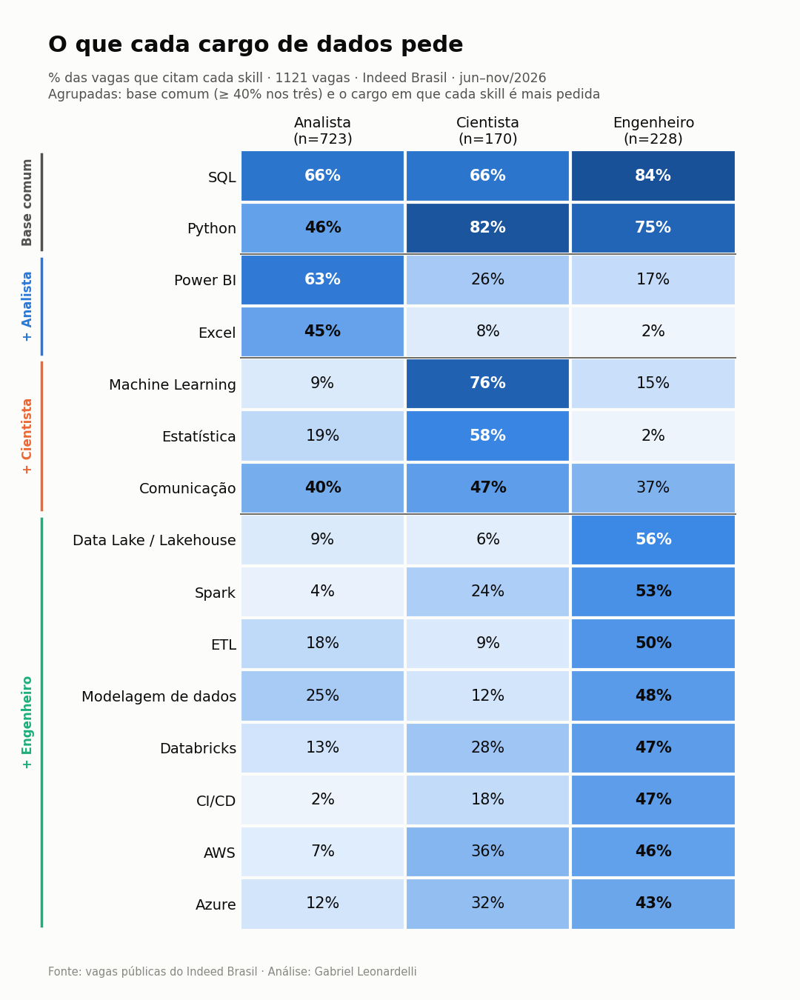
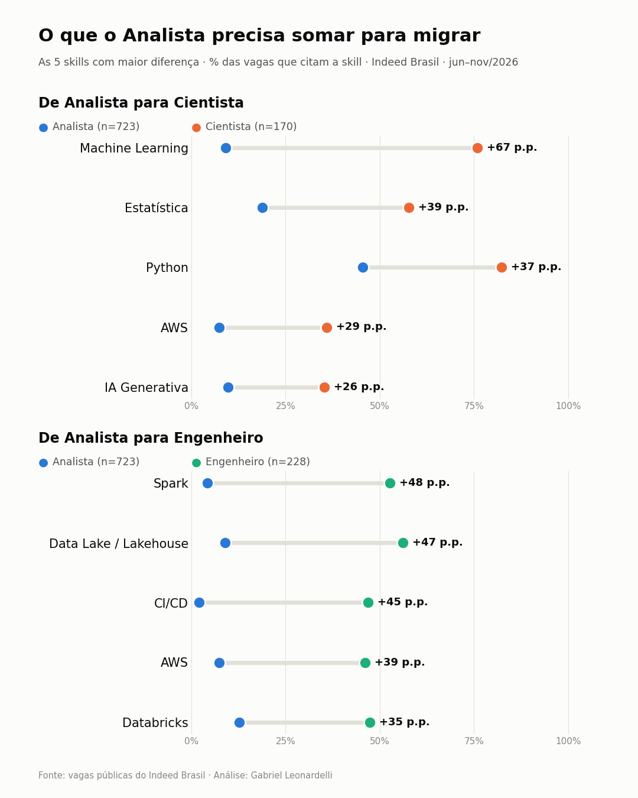

# 📊 Analista × Cientista × Engenheiro de Dados: onde as skills se cruzam

> Projeto 2 da série. O projeto 1 ([skills-analista-dados](https://github.com/GabrielLeo12/skills-analista-dados)) mediu as skills pedidas para Analista de Dados. Este compara os três cargos e mostra o que um analista precisa somar para migrar.

**1.121 vagas** do Indeed Brasil (jun–nov/2026): **723 Analista · 170 Cientista · 228 Engenheiro**.



## 🔑 Principais resultados
- **Base comum:** só **SQL** (66% · 66% · 84%) e **Python** (46% · 82% · 75%) aparecem em pelo menos 40% das vagas dos três cargos.
- **O Analista está mais perto do Cientista do que do Engenheiro** (similaridade de cosseno 0,72 contra 0,68). O resultado se mantém em 4 variações do cálculo e em 98% de 300 reamostragens das vagas.
- **Para virar Cientista**, as maiores pontes são Machine Learning (9% → 76%), Estatística (19% → 58%) e Python (46% → 82%).
- **Para virar Engenheiro**, são Spark (4% → 53%), Data Lake / Lakehouse (9% → 56%) e CI/CD (2% → 47%).
- **O que é só do Analista:** Power BI (+42 p.p. sobre a média dos outros dois) e Excel (+40 p.p.).
- **Trabalho remoto:** 35% das vagas de Engenheiro, 23% de Cientista e 11% de Analista.



## ⚙️ Como foi feito

| Etapa | O que acontece | Arquivo |
|---|---|---|
| 1. Coleta | 18 buscas no Indeed Brasil (termos por cargo + júnior/pleno/sênior no termo principal), pedindo vagas de até 180 dias | `src/coleta.py` |
| 2. Limpeza | Junta com os brutos do projeto 1 (só Analista), remove repetidas, classifica o cargo pelo título, aplica a janela comum | `src/limpeza.py` |
| 3. Validação | Gera amostras de trechos por skill e de títulos por cargo para leitura | `src/validacao.py` |
| 4. Análise | Perfil por cargo, base comum, skills características, similaridade, pontes, gráficos | `src/analise.py`, `src/graficos.py` |

**Métrica:** % = vagas do cargo que citam a skill ÷ total de vagas do cargo (igual ao projeto 1).

### Janela de tempo
Pedimos 6 meses, mas o Indeed só devolve vagas **ainda ativas**: no projeto 1, pedindo 120 dias, a vaga mais antiga era de 24/jul e mais de 75% eram de outubro e novembro. Por isso a análise usa só o período coberto pelos **três cargos ao mesmo tempo** (`JANELA_INICIO = "auto"`), para que nenhum cargo tenha vagas de uma época que os outros não têm.

### Reaproveitamento do projeto 1
Os brutos do projeto 1 (mesma fonte, mesma ferramenta, coleta de 21/11) entram **só para Analista**. As vagas de Cientista e Engenheiro que apareceram lá vieram de buscas por "analista" e seriam uma amostra enviesada; para esses cargos, só valem as buscas novas.

### Classificação do cargo pelo título
Ordem de prioridade (a primeira regra que bater decide):
1. **O título nomeia o cargo** (engenheiro/a de dados, data engineer, cientista de dados, data scientist) → esse cargo. Ex.: *Cientista de Dados Sênior | MLOps* → Cientista.
2. **Híbridos** → excluídos (tabela abaixo).
3. **O título cita a área** (engenharia de dados, ciência de dados) → esse cargo. A área vale mais que a palavra "Analista": *Analista de Engenharia de Dados* → Engenheiro; *Analista de Ciência de Dados* → Cientista.
4. **Analista** (mesmas regras do projeto 1).
5. Outra área.

Os padrões aceitam forma feminina e "(a)" (inclusive "Engenheiro (a)", com espaço), abreviações (*Eng. de Dados*) e erros de digitação (*Cientísta*, *Engenheria*, *Inteligence*).

| Regra | Padrão |
|---|---|
| Engenheiro (nome) | `engenheir[oa]\S*(?:\s*\(a\))? (de )?dados\|\beng\.? (de )?dados\|data engineer\|big data engineer\|engenheir[oa]\S* de big data` |
| Cientista (nome) | `cientista (de )?dados\|data scientist` |
| Engenheiro (área) | `engenh?[ae]ria de dados\|data engineering` |
| Cientista (área) | `ciencias? de dados\|data science` |
| Analista | inclui `analista\|analyst\|analytics\|analise de dados\|estagi\|\bbi\b\|business intel\|inteligencia de negocios` **e** tema `dado\|data\|\bbi\b\|business intel\|analytics\|inteligencia de negocios\|power bi` **e não** `desenvolvedor\|developer\|dba\b\|arquitet\|architect\|engenheir\|engineer\|cientista\|scientist` |

**Híbridos excluídos: 88 vagas.** AI Engineer (49), Arquiteto de Dados (15), Analytics Engineer (15), Machine Learning Engineer (7) e MLOps (2). Eles misturam duas áreas e poluiriam a comparação.

| Cargo híbrido | Padrão |
|---|---|
| Analytics Engineer | `analytics engineer\|engenheir[oa]\S*(?:\s*\(a\))? de analytics\|engenharia de analytics` |
| Machine Learning Engineer | `(machine learning\|\bml\b) engineer\|engenheir[oa]\S*(?:\s*\(a\))? (de )?(machine learning\|aprendizado de maquina\|\bml\b)` |
| MLOps | `\bmlops\b\|\bml ops\b` |
| Arquiteto de Dados | `arquitet[oa]\S* de dados\|data architect\|arquitetura de dados` |
| AI Engineer | `\bai engineer\|engenheir[oa]\S*(?:\s*\(a\))? de (ia\|inteligencia artificial)\b` |

### Funil
| Etapa | Vagas |
|---|---|
| Coletadas (projeto 2 + brutos do projeto 1, com repetidas) | 15.133 |
| Sem repetidas | 6.715 |
| Do projeto 1, fora de Analista (descartadas) | 913 |
| Híbridos excluídos | 88 |
| Outra área | 4.591 |
| Dos 3 cargos, com descrição | 1.122 |
| **Na janela comum (desde 02/06/2026)** | **1.121** |

"Outra área" é grande porque a busca do Indeed é solta: "engenheiro de dados" traz engenheiro de software, civil e de automação, por exemplo.

### Skills (47)
As 29 do projeto 1 + 18 novas de engenharia e ciência. Mesmas regras do projeto 1: *KPIs / Indicadores* fica fora dos rankings; *Estatística* não conta quando aparece só como curso de formação.

**Mudança em relação ao projeto 1:** lá, *Data Warehouse* também contava "data lake". Aqui, *Data Lake / Lakehouse* tem padrão próprio, para o mesmo conceito não aparecer duas vezes.
**Sobreposições intencionais:** *AWS* inclui Redshift e Athena; *GCP / BigQuery* inclui BigQuery; *Python* conta menções a pandas.

| Skill | Categoria | Padrão |
|---|---|---|
| SQL | Linguagem | `\bsql\b\|t-sql\|pl/sql\|\bmysql\b\|postgres\|sql server\|\boracle\b` |
| Python | Linguagem | `\bpython\b\|\bpandas\b` |
| R | Linguagem | `\blinguagem r\b\|\bpython\s*(?:e\|ou\|/\|,)\s*r\b\|\br\s*(?:e\|ou\|/\|,)\s*python\b\|\brstudio\b\|\btidyverse\b` |
| DAX | Linguagem | `\bdax\b` |
| VBA / Macros | Linguagem | `\bvba\b\|\bmacros?\b` |
| Excel | Planilha | `\bexcel\b\|planilhas? eletronicas?` |
| Google Sheets | Planilha | `google sheets\|planilhas? (?:do )?google` |
| Power BI | Visualização | `power ?bi\|\bpbi\b` |
| Tableau | Visualização | `\btableau\b` |
| Looker | Visualização | `\blooker\b\|data studio` |
| Qlik | Visualização | `\bqlik` |
| AWS | Cloud | `\baws\b\|amazon web services\|redshift\|\bathena\b` |
| Azure | Cloud | `\bazure\b\|synapse\|data factory\|microsoft fabric` |
| GCP / BigQuery | Cloud | `\bgcp\b\|google cloud\|bigquery` |
| ETL | Engenharia de dados | `\betl\b\|\belt\b` |
| Data Warehouse | Engenharia de dados | `data ?warehouse\|\bdw\b\|\bedw\b` |
| Modelagem de dados | Engenharia de dados | `modelagem de dados\|data model\|modelo dimensional\|star schema\|modelagem dimensional` |
| Databricks | Engenharia de dados | `databricks` |
| Spark | Engenharia de dados | `\bspark\b\|pyspark` |
| Airflow | Engenharia de dados | `airflow` |
| dbt | Engenharia de dados | `\bdbt\b` |
| Git | Engenharia de dados | `\bgit\b\|github\|gitlab` |
| Estatística | Conceito | `estatistic\|statistic` |
| Machine Learning | Ciência de dados | `machine learning\|aprendizado de maquina\|\bml\b` |
| IA Generativa | Ciência de dados | `ia generativa\|genai\|generative ai\|\bllms?\b\|chatgpt\|engenharia de prompt` |
| KPIs / Indicadores | Conceito | `\bkpis?\b\|indicadores` |
| Storytelling | Conceito | `storytelling` |
| Comunicação | Comportamental | `comunicacao\|comunicativ\|communication` |
| Inglês | Idioma | `\bingles\b\|\benglish\b` |
| Kafka | Engenharia de dados | `\bkafka\b` |
| Snowflake | Engenharia de dados | `(?<!star/)(?<!star )(?<!schema, )\bsnowflake\b(?!\s*schema)` |
| BigQuery | Cloud | `\bbig ?query\b` |
| Redshift | Cloud | `\bredshift\b` |
| Data Lake / Lakehouse | Engenharia de dados | `data ?lake\|lakehouse\|delta lake` |
| Docker | DevOps | `\bdocker\b` |
| Kubernetes | DevOps | `\bkubernetes\b\|\bk8s\b` |
| CI/CD | DevOps | `\bci ?/ ?cd\b\|integracao continua\|entrega continua\|github actions\|gitlab ci\|\bjenkins\b` |
| Terraform | DevOps | `\bterraform\b` |
| Linux | DevOps | `\blinux\b\|\bunix\b\|\bshell script\|\bbash\b` |
| Scala | Linguagem | `\bscala\b` |
| Java | Linguagem | `\bjava\b(?!\s*script)` |
| Deep Learning | Ciência de dados | `deep learning\|aprendizado profundo\|redes neurais\|neural networks?` |
| scikit-learn | Ciência de dados | `scikit\|sklearn` |
| TensorFlow / PyTorch | Ciência de dados | `tensorflow\|pytorch\|\bkeras\b` |
| NLP | Ciência de dados | `\bnlp\b\|\bpln\b\|processamento de linguagem natural\|natural language processing` |
| Testes A/B | Ciência de dados | `\btestes? (?:a ?/ ?b\|ab)\b\|\ba ?/ ?b test\|\bab test` |
| Pandas | Linguagem | `\bpandas\b` |

### Decisões de validação
Li amostras de 15 trechos por skill nova e títulos de cada cargo. O que mudou:
- **Títulos com "Engenheiro (a)"**, com espaço, e "Ciências de Dados" no plural ficavam de fora. Os padrões foram corrigidos.
- **Títulos que nomeiam o cargo agora vencem os híbridos.** "Cientista de Dados Sênior | MLOps" era excluído como MLOps; agora conta como Cientista.
- Com essas duas correções, Cientista passou de 164 para 170 vagas e Engenheiro de 221 para 228.
- **Snowflake:** "star/snowflake schema" é modelagem de dados, não a plataforma. Excluído do padrão (Engenheiro: 24 → 18 vagas).
- **CI/CD:** "Azure DevOps" aparecia como ferramenta de gestão de projetos e versionamento. Saiu do padrão (Analista: 25 → 15 vagas).
- **Proximidade:** a manchete "o Analista está mais perto do Cientista" foi testada sem SQL e Python, só com as skills relevantes, com valores centrados e em 300 reamostragens das vagas. Ela se manteve em todas as variações e em 98% das reamostragens.

### Limitações
- Uma única fonte (Indeed Brasil). A janela vai de junho a novembro, mas 75% das vagas são de outubro e novembro (o Indeed só mostra vagas ativas).
- **A amostra de Cientista é pequena (170 vagas):** a busca principal trouxe 428 resultados, abaixo do teto de 1.000, ou seja, o Indeed entregou tudo o que tinha.
- O título nem sempre reflete o trabalho real (muita vaga de "Analista" faz engenharia, por exemplo).
- A busca por palavras não diferencia "obrigatório" de "diferencial".
- Júnior × Sênior só foi possível para Analista (78 júnior × 201 sênior). Cientista e Engenheiro têm menos de 50 vagas júnior.
- O modelo de trabalho é inferido do texto: de 32% a 45% das vagas não informam.

## ▶️ Como rodar
```bash
python -m venv .venv
.venv\Scripts\activate          # Mac/Linux: source .venv/bin/activate
pip install -r requirements.txt
python main.py                   # coleta + limpeza + amostras + análise
python main.py --pular-coleta    # sem coletar de novo
```
Para juntar os dados do projeto 1, deixe as duas pastas lado a lado (`../skills-analista-dados/data/raw`).

## 📁 Resultados (`outputs/tabelas/`)
`perfil_cargos.csv` (todas as skills × cargos) · `top10_por_cargo.csv` · `base_comum.csv` · `caracteristicas.csv` · `similaridade.csv` · `pontes.csv` · `senioridade_por_cargo.csv` (só se houver amostra) · `modelo_trabalho.csv` · `funil.csv` · `base_dashboard.csv` (Power BI) · `resumo.md`

---
Feito por **Gabriel Leonardelli**
